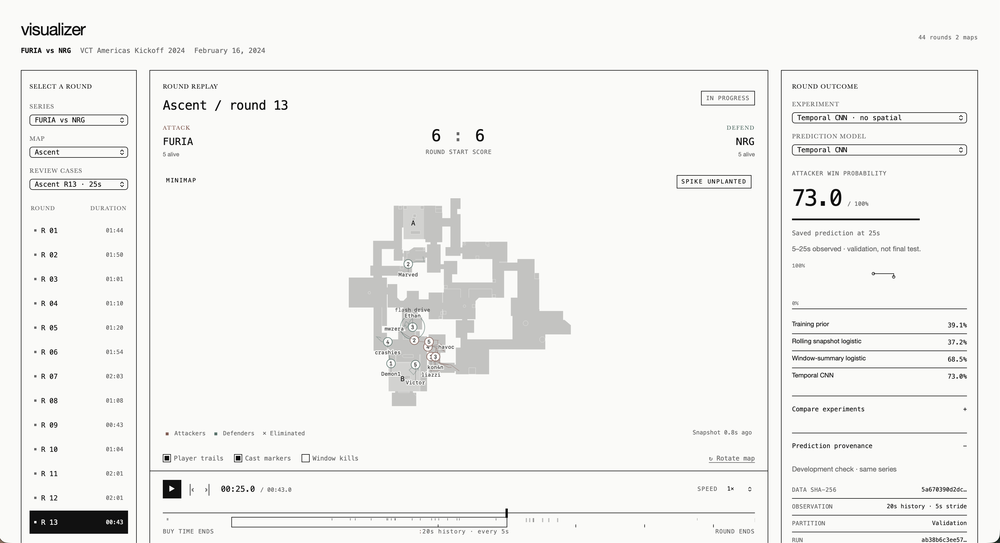

# VALORANT Round-Outcome Modeling

I applied a temporal CNN to professional VALORANT rounds to estimate attacker
round-win probability from recent utility, combat, positioning, economy, and
objective state. The model receives 20 seconds of observations and updates
every five seconds. I designed its features from my experience as a competitive
VALORANT player. This began as my undergraduate ML final project and I have continued building off of it after graduation.

The dataset contains 44 rounds from Breeze and Ascent in one FURIA–NRG series:
VCT Americas Kickoff, February 16, 2024. Its 555 overlapping windows are not
independent samples, and there is no independent test set.
[Results so far](#results-so-far), and what a sample this small can show, are at
the end.

## Feature design from competitive play

I chose what the model should watch for from how rounds are actually played. In
priority order: utility combinations before contact, movement after
information-gathering casts, and trades.

- **Rolling 5-second predictions.** The model looks at the last 20 seconds of
  a round and makes a new prediction every 5 seconds.
- **What happened in each sequence.** The inputs describe the events in that
  window: utility used, kills, positions, economy, and the spike. Abilities are
  grouped by what they do (smoke, flash, recon, damage, and so on).
- **Trades.** A return kill within five seconds of a teammate's death counts as
  a candidate trade.
- **Replay review.** I reviewed flagged review cases from
  [untrained utility/movement prototype](entry_support.py) by hand, comparing against the
  broadcast.
- **Channels from those reads.** A second set of channels,
  [`utility_structure.py`](utility_structure.py), follows from my verdicts and
  design decisions: how many different players have support utility live at
  once, how many different functions it covers, and whether an attacker's entry
  dash had a teammate's utility close to it.

## Model and comparisons

The v2 model has 222 input channels and 2,602 parameters. It uses
shared ability functions instead of ability-specific channels and excludes map,
player, team, and agent identities. Cast locations, kill origin/victim locations,
alive counts, economy, reported health, and objective state remain available.
Coordinates still reflect map geometry; removing the map indicator does not make
the representation map-invariant.

Comparisons include a training prior, snapshot logistic regression, history-summary
logistic regression, and a similarly sized neural control that pools independently
encoded bins. Feature ablations remove groups of utility, spatial observations,
and trade proxies; other inputs may retain correlated information. Every model
uses the same training-only support rule: channels constant
in training stay zero during validation and inference.
Feature definitions and their limits are in `rolling_features.py`.

The feed records casts, not successful blinds or reveals. Sparse position reports
support limited displacement measurements, not verified rotations or map control.
This is retrospective analysis of spectator state. Associations in predictions
cannot establish that an action caused a change in win probability.

## Visualizer



View the visualizer and saved data on a fresh clone:

```bash
python3 -E -S -B serve.py --data-dir data --port 8771 --comparison-config demo/comparison.json
```

Open [the visualizer](http://127.0.0.1:8771/). Select a map and round, then play
or scrub the timeline. It shows calibrated minimaps, player states, raw ability
names, kills, observation windows, and position-report coverage. Hover an
ability-use chip to inspect its provisional function tags.

From 20 seconds into a round it also shows the saved attacker win probability
for the selected run beside its logistic baselines. [`demo/`](demo/README.md)
holds validation predictions and run manifests for eight runs: full and reduced
inputs, temporal CNN and pooled control, for each map. Seed 42 is fixed for
inspection independently of scores. Changing **Experiment** changes the complete
run and its provenance together.

**Review cases** lists the seven windows I reviewed, starting with Ascent round
13 at 25s, focused on mwzera. Selecting one hides probabilities; uncheck
**Hide probabilities** after forming your own read. Expand a movement pair to
inspect casts or highlight its observed displacement on the map. These prototype
features do not affect any displayed prediction.

To replay events without predictions:

```bash
python3 -E -S -B serve.py --data-dir data --port 8767
```

To load a single run on both maps, pass its two files directly. The map it
trained on then shows training predictions, labeled as such:

```bash
python3 -E -S -B serve.py --data-dir data --port 8769 \
  --rolling-predictions demo/ascent-all-temporal_cnn-seed42/predictions.jsonl \
  --rolling-run-manifest demo/ascent-all-temporal_cnn-seed42/run.json
```

## Changes from the class project

- Replaced whole-round inputs with causal windows excluding future events and
  resolved outcomes; time starts after buy time.
- Corrected team lookup and series IDs, validated source data, and tested
  corrections, side changes, timestamp boundaries, and partition overlap.
- Grouped windows by series for evaluation. The two-map development mode keeps
  each map together and makes no independent-test claim.
- Added baselines, a neural control, feature ablations, and equal total weight
  per round. Validation log loss averaged by round selects checkpoints.
- Bound predictions to data, schemas, input policies, artifacts, and partitions.
- Replaced Hub/Transformers wrappers with local model code and safetensors.
  Original whole-round checkpoints and generated reports are excluded.

The earlier fixed-cutoff pipeline (`train.py`, `predict.py`) remains available.
New exports can enter the ingestion pipeline in `data_processing.py`. Independent
matches are needed before claiming generalization; more windows from these
rounds do not resolve that limitation.

## Source layout

| Files | Purpose |
| --- | --- |
| `data_processing.py`, `data/` | Event ingestion, validation, provenance |
| `rolling_features.py`, `ability_taxonomy.py` | Observations and shared cast functions |
| `rolling_inputs.py` | Training-only masks and feature-family controls |
| `rolling_model.py`, `rolling_experiment.py` | Neural models, baselines, metrics |
| `train_rolling.py`, `predict_rolling.py` | Approved-runtime training and export |
| `audit_rolling.py`, `audit_inputs.py` | Standard-library audits |
| `entry_support.py`, `comparison_data.py` | Untrained relationship evidence and separately verified comparison runs |
| `utility_structure.py` | Cast-structure channels built from my case review |
| `structure_inputs.py`, `plan_structure.py` | Extension inputs beside the frozen v2 contract; run-plan tool |
| `structure_model.py`, `train_structure.py`, `predict_structure.py` | Approved-runtime training with extension channels |
| `serve.py`, `replay_data.py`, `viewer/` | Local replay and prediction inspection |
| `demo/` | Saved validation predictions and run manifests for the visualizer |
| `tests/`, `tests_ml/` | Separate standard-library and optional ML tests |
| `schemas/` | Historical contracts for JSON replay |

## Results so far

So far the temporal CNN has not shown an advantage over simpler models on this
data.

- In a [three-seed follow-up](docs/experiment-results.md#completed-reduced-input-seed-check),
  removing the current spatial features improved log loss in 11 of 12 matched
  neural comparisons, and the pooled neural control had better average log loss
  than the temporal CNN on both maps.
- The channels from my replay review did not lower validation log loss. I
  tested them in a
  [36-run experiment](docs/experiment-results.md#completed-utility-structure-experiment)
  under a hash-bound plan. All 12 saved control runs were reproduced exactly
  first. The new channels then beat both the base run and a volume placebo in
  4 of 12 matched pairs, against a threshold of 9 fixed in advance
  ([results](docs/utility-structure-results.json)).

The sample limits what these results can say. My API access ended after the
hackathon, so the dataset stops at 44 rounds from one series. Most differences
between models here are about 0.01 in log loss or less, while the same model
varies from 0.30 to 0.37 across random seeds on Ascent. A sample this small cannot
separate an effect of that size from noise, so these results do not tell me
whether the approach would help with more data. Answering that needs more
independent matches.

The [full-input study](docs/experiment-results.md#completed-12-run-study),
[feature ablations](docs/experiment-results.md#completed-feature-ablations),
and follow-ups retain every outcome, including weaker runs.
