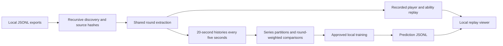

# Event data, replay, and experiments

The viewer now defaults to 20-second rolling windows every five seconds. See
[rolling-design.md](rolling-design.md) for the multimodal feature contract and
evaluation protocol. Rolling prediction imports use `--rolling-predictions` and
`--rolling-run-manifest`; the fixed-cutoff integration documented below remains
available for the earlier experiment. Both paths load prediction JSON only.

The project uses the event data supplied through the Riot API during the
hackathon. Access ended with that event; existing exports remain usable offline.
The current adapter reads the supplied JSONL's GRID-style event envelope. Data
from another API response format would need an adapter to the same round records.



## Adding data when it becomes available

Place complete event streams under `data/`, including nested directories:

```text
data/
  events_2629390_grid.jsonl
  another-series/
    events.jsonl
```

The audit, training command, and viewer share recursive discovery. They identify
rounds by `(series_id, game_id, round_id)` and reject duplicate rounds across
files. Keep prediction JSONL and model outputs in `runs/`, not the input tree.
Restart the viewer to index new files. This requires no API access or network
ingestion service. Exports must retain complete round boundaries.

```bash
python3 -E -S -B rolling_features.py data
python3 -S -B serve.py --data-dir data --port 8765
```

Training already groups normal experiments by series. Additional series become
available to the partitioner without code edits; at least three are required for
train/validation/test. That minimum does not establish statistical reliability.
The existing single series remains useful for replay and development checks.

## Replay semantics

The replay uses the last snapshot at or before the selected timestamp. Missing
fields retain their prior reported state. Missing positions remain missing. It
does not interpolate paths or movement. Trail lines connect reported positions
from the last ten seconds; they do not establish the route between observations.
The clock measures feed time after buy time ends, consistent with feature extraction.

Breeze and Ascent use archived minimap images. Their normalized coordinates are
`image_x = world_y * xMultiplier + xScalarToAdd` and
`image_y = world_x * yMultiplier + yScalarToAdd`. Rotation transforms the artwork
and every overlay together. Unknown maps fall back to the export's coordinate
bounds and are labeled as a coordinate view. Asset sources, hashes, and calibration
are in `viewer/maps/manifest.json`. Ability
rings briefly identify the caster's reported position, not an impact point,
range, trajectory, or effect duration. Readiness is the last reported state.
Kills, plants, casts, and outcomes are revealed as the replay reaches them.

The rolling panel advances to each eligible five-second endpoint after its initial
20-second warm-up. It shows the current window's ability uses, kills, candidate
trades, position coverage, and a selection of state channels. Saved probabilities
are revealed only when the scrubber reaches their timestamps. The earlier
fixed-cutoff mode instead freezes its features and prediction at that run's cutoff.
Replay continues afterward, and rounds without eligible windows remain viewable.

## Earlier fixed-cutoff prediction integration

The viewer imports JSON data only and never imports ML libraries or opens model
weights. Until approved training exists, it displays “No predictions loaded.”
An approved training run writes `predictions.jsonl` for all its eligible rounds.
To export predictions for an additional local stream with that same run:

```bash
.venv/bin/python predict.py runs/example data/events_2629390_grid.jsonl \
  > runs/example/replay.jsonl
python3 -S -B serve.py --data-dir data --predictions runs/example/replay.jsonl \
  --run-manifest runs/example/run.json
```

Each schema-v2 row supplies round identity, source SHA-256, run ID and manifest
SHA-256, feature schemas, observation cutoff, partition, model artifact hashes,
and a probability for every model in the run. The server requires the matching
completed manifest and checks those fields, the actual replay file hash, finite
probability bounds, duplicates, and cutoff eligibility. Legacy prediction rows
without provenance are rejected. It does not open model artifacts.

The viewer offers the training prior, snapshot logistic, temporal-summary logistic,
and CNN if present. It shows partition, run, cutoff, feature versions, and shortened
hashes (full values on hover). Training rounds are explicitly labeled as used for
fitting. Same-series smoke runs are marked as development checks; unknown rounds
are unassigned, never automatically called held-out test data. A fixed-cutoff
prediction remains fixed afterward; it is not continuous inference.

Hashes detect inconsistent files; they are not signatures or proof that a model
was trained correctly. The prediction CLI checks the actual fitted artifact hashes
before loading them. The viewer checks declared artifact hashes against the manifest.
Synthetic UI fixtures must declare `purpose: ui_fixture`; they are visibly labeled
and cannot be used as model runs by the prediction CLI.

## Local server boundary

The server binds to `127.0.0.1` and serves an explicit allowlist of frontend and map assets, the source
catalog, and compact per-round JSON. It does not expose the project directory,
accept uploads, write files, call APIs, or load models. It rejects non-loopback
Host headers and cross-origin browser requests. Frontend scripts, fonts, and
styles are local; no CDNs or analytics are used. This is a local development
viewer, not an authenticated multiuser service.

## Proposed next changes

1. Persist a dataset manifest and explicit series split files so adding exports
   cannot accidentally change an established test set.
2. Add versioned map artwork and calibration as new maps enter the dataset.
   Verify layouts against the match patch before enabling them.
3. After approved ML validation, export predictions from the rolling model at its
   five-second observation endpoints. Compare calibration and performance at each
   elapsed time; a changing probability is not by itself evidence of calibration.
4. Publish a short walkthrough of one round, the feature representation, and a
   baseline comparison when those results exist. Keep the one-series limitation
   visible, while explaining how the implementation accommodates future data.

## Match context and map assets

The bundled series is FURIA vs NRG at VCT Americas Kickoff 2024, Group A opening
match, February 16, 2024 (Los Angeles match date). The export identifies tournament
757073, series 2629390, the teams, and timestamps. The tournament's readable name
is corroborated by the [official VCT Americas broadcast](https://www.youtube.com/watch?v=HDnaNZhU1Wc).
The source series began at 21:51:12 UTC on February 16 and ended at 00:31:51 UTC
on February 17. The displayed date belongs to the match, not the hackathon.

`data/series.json` supplies optional human-readable context keyed by series ID.
It is applied only when its source SHA-256 matches the export. New series without
verified context show their teams and earliest completed-round date in UTC;
the viewer does not assign this tournament to unrelated data.

Map artwork is owned by Riot Games. The local PNGs come from pinned historical
image revisions, listed with hashes in `viewer/maps/manifest.json`. Breeze uses
the September 2024 archive with A Cave closed and A Hall open, consistent with
Riot's [8.01 map changes](https://playvalorant.com/en-us/news/game-updates/valorant-patch-notes-8-01/).
Ascent uses the September 2024 archive. These are orientation aids, not collision
meshes; they do not model wall penetration, elevation, or ability footprints.
The normalized calibration values were checked against the
[map metadata provider](https://valorant-api.com/v1/maps). No code from the asset
repositories is imported or executed, and assets are served from localhost.
